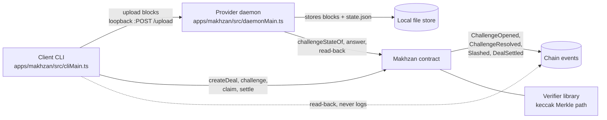

# Makhzan

Bonded, challenge-verified storage on Portaldot, with an accountable AI agent as its first customer.

## Repository

https://github.com/MohammedSoliman10/portaldot-hackathon-2026-makhzan-soliman

## Status

**Tier 1 is implemented and verified locally only.** Every contract, daemon, CLI and end-to-end
result below ran against a local anvil chain with public test accounts. Nothing has been deployed to
the Portaldot testnet, no live RPC has been called, and the live rows are marked
`[pending live run]`. The local results are in [evidence/tier1-results.md](evidence/tier1-results.md);
the live plan is [docs/live-runbook.md](docs/live-runbook.md).

## Implemented / simulated / roadmap

| Capability | State | Evidence |
| --- | --- | --- |
| Merkle block commitment over a file, shared by Solidity and TypeScript (golden vectors, leaf counts 1, 3, 7, 1000) | implemented, local | `evidence/raw/t1/05-vectors.txt`, `11-ts-merkle-green.txt`, `15-interface-green.txt` |
| Provider registry with a minimum bond and a 2-slot layout | implemented, local | `evidence/raw/t1/17-registry-green.txt`, `21-slots-green.txt` |
| Deal creation: root, size, leaf count, price escrow, duration | implemented, local | `evidence/raw/t1/19-deals-green.txt`, `22-us1-independent.txt` |
| Challenge: random index from the D5 fallback, deadline, expected path length | implemented, local | `evidence/raw/t1/24-challenge-green.txt`, `26-challenge-slots-green.txt` |
| Answer verification, pass with no bond movement, 20% slash on `resolve` | implemented, local | `evidence/raw/t1/31-rounds-green.txt`, `48-e2e-local.txt` |
| Pull payments: `claim`, `settle`, exactly-once accounting | implemented, local | `evidence/raw/t1/28-payments-green.txt`, `48-e2e-local.txt` |
| Provider daemon: poll, rebuild the path, submit, label only from read-back, per-deal isolation, bounded retries | implemented, local | `evidence/raw/t1/44-daemon-red.txt`, `59-daemon-evidence-green.txt` |
| Client CLI: upload, create, challenge, watch, claim, settle, resolve, report; env-only keys | implemented, local | `evidence/raw/t1/46-cli-red.txt`, `47-cli-green.txt`, `63-entrypoints-green.txt` |
| CLI and daemon entry points with viem wiring, explicit network, graceful stop, five-state logs | implemented, local | `evidence/raw/t1/62-entrypoints-red.txt`, `63-entrypoints-green.txt` |
| Network-explicit deploy command (`scripts/deploy.mjs`): dry-run estimate in tPOT, DR-012 reserve guard, code-length and config read-back, deployment record | implemented, local | `evidence/raw/t1/60-deploy-red.txt`, `61-deploy-green.txt`, `64-e2e-process.txt` |
| Sanitised round evidence writer and the report hook | implemented, local | `evidence/raw/t1/53-evidence-red.txt`, `54-evidence-green.txt` |
| Deployed size budget, enforced in CI (10,240 B; actual 6,378 B with `via_ir`) | implemented, local | `evidence/raw/t1/49-size-check.txt`, `50-size-check-red.txt` |
| Gas snapshot and drift check | implemented, local | `evidence/raw/t1/51-gas-snapshot.txt` |
| Full CI command list, both jobs, one compiler profile | implemented, local | `evidence/raw/t1/52-ci-local.txt` |
| 1 MiB / 1,024-block pass and slash round, then settle, on anvil | implemented, local | `evidence/raw/t1/48-e2e-local.txt` |
| Process-level round (separate deploy, daemon and CLI processes), skip drill + `resolve`, exactly 20% slash and owner credit | implemented, local | `evidence/raw/t1/64-e2e-process.txt`, `evidence/deployments/` |
| Live deployment, live rounds, live fee/`WEI_PER_UNIT` measurement | `[pending live run]` | none — blocked on G01–G05/G07 |
| Front-end, agent client, indexed history, pull-payment escrow contract | roadmap | not started (Tier 2+) |
| Randomness beyond the D5 fallback | roadmap, blocked on G03 | not started |
| PolkaVM (`resolc`) deployment path | simulated only (compiler probe, Tier 0) | `evidence/raw/t1/` tier-0 gates |

## Architecture



The daemon never trusts its own transaction hash: a round is `submitted` after the send and only
becomes `passed`/`failed` from a fresh `challengeStateOf` read-back plus the provider bond.

## Demo (3 minutes)

The full script is [docs/demo.md](docs/demo.md). Short version:

```bash
cd contracts && forge build --sizes && cd ..
node scripts/check-size.mjs                     # 6,378 B <= 10,240 B
cd apps/makhzan && npm test                     # 93 TypeScript tests
node scripts/e2e-local.mjs                      # anvil: one pass, one slash, then settle
```

Expected: the size check prints the margin, the tests pass, and the e2e ends with
`PASS — SC-001 (one passed challenge) and SC-002 (one slashed challenge) on local anvil`. See
[specs/002-core-storage-proofs/quickstart.md](specs/002-core-storage-proofs/quickstart.md) for the
step-by-step version of the same path.

## Build and test

```bash
cd contracts && forge fmt --check && forge build --sizes && forge test -vvv && forge snapshot --check
node scripts/check-size.mjs
cd apps/makhzan && npm ci && npm run typecheck && npm test
```

`Makhzan` runtime is 6,378 B (creation 6,966 B) against a 10,240 B budget, measured with
`via_ir = true` (DR-012). The compiler, optimizer and `via_ir` flags live only in
`contracts/foundry.toml`; CI inherits them and must not duplicate them.

## Known limits

- **Identical blocks are interchangeable by design**: the leaf hash commits only the 1,024 bytes, so
  identical blocks (and whole identical subtrees) are answered by one stored copy. This does not
  reduce what a provider must store for a distinct file, and it is documented rather than hidden
  (FR-017, DR-011).
- **A pass proves one block inside a response window**, not continuous local storage. Nothing in the
  protocol observes the disk between challenges.
- **One bond backs every deal a provider holds.** The bond is the economic bound, not a per-deal
  deposit. A provider with many deals risks the same bond once.
- **A value-rejecting owner or provider can block its own payouts** and, through `resolve`, the
  counterparty's exit. Tier 1 assumes externally owned accounts for both roles; pull payments with a
  separate escrow are a Tier 2 item.
- **The challenge index source is the D5 fallback** (parent hash, prevrandao, deal id) until the
  randomness gate (G03) rules. It is not claimed unpredictable yet.
- **The unit price `WEI_PER_UNIT = 10,000` is an assumption** until the live fee schedule (G05/G07)
  is measured; every local number in `evidence/tier1-results.md` depends on it.
- **Live behaviour is unverified.** Block time, retrieval window and fee numbers on the Portaldot
  testnet are `[pending live run]`.

## AI assistance

This project is built with AI assistance. AI-assisted parts are marked in commits with `[ai]` and
disclosed here as they appear:

- Repo skeleton, `.gitignore`, `.env.example`, `AGENTS.md`: AI-written.
- The deploy command, the CLI/daemon entry points and the process-level e2e (batch 7): AI-written.
- Spec Kit scaffolding (`.specify/`, `.opencode/commands/speckit.*`): generated by GitHub Spec Kit
  (AI-assisted workflow tooling).
- Tier-0 gate harness (`apps/gates/`): AI-written TypeScript, reviewed by the owner at each
  checkpoint.
- Probe contracts under `contracts/src/tier0/`: AI-written, disposable, deleted or quarantined before
  the product tier.
- Tier-1 contract (`contracts/src/makhzan/`), verifier, provider daemon, CLI, evidence writer, size
  check, gas snapshot, CI workflow, demo and docs: AI-written, reviewed by the owner at each batch
  checkpoint. This README and `evidence/tier1-results.md` are AI-written from recorded command
  output, not from memory.

## Third-party software

No new library was added for Tier 1. `apps/makhzan` reuses the same pinned `viem` install as
`apps/gates` (resolved from that tree by relative import), and both lockfiles are committed.

| Component | Version | Licence |
| --- | --- | --- |
| [GitHub Spec Kit](https://github.com/github/spec-kit) (`specify-cli`) | v1.2.2 | MIT |
| [Foundry](https://github.com/foundry-rs/foundry) (`forge`, `cast`, `anvil`) | 1.8.5 | MIT / Apache-2.0 |
| [forge-std](https://github.com/foundry-rs/forge-std) | 1.17.0 | MIT |
| [resolc](https://github.com/paritytech/revive) (PolkaVM fallback compiler) | 1.4.0 | Apache-2.0 |
| [Node.js](https://nodejs.org/) | 24.20.0 | MIT |
| [viem](https://viem.sh/) | 2.57.7 | MIT |
| [@polkadot/api](https://github.com/polkadot-js/api) | 17.0.2 | Apache-2.0 |
| [@polkadot/util](https://github.com/polkadot-js/common) | 14.0.3 | Apache-2.0 |
| [@polkadot/util-crypto](https://github.com/polkadot-js/common) | 14.0.3 | Apache-2.0 |
| [TypeScript](https://www.typescriptlang.org/) | 5.9.3 | Apache-2.0 |
| [@types/node](https://github.com/DefinitelyTyped/DefinitelyTyped) | 24.19.2 | MIT |

### Compiler paths

The primary path is standard Foundry/`solc` (EVM bytecode), because the chain reports
`allowEVMBytecode=true`. The fallback path compiles the same Solidity source with the official
`resolc` 1.4.0 CLI into a PolkaVM blob. Standard Foundry 1.8.5 has no `--resolc` flag; the
ParityTech `foundry-polkadot` fork is the only supported `forge build --resolc` path and is not
installed here. Both paths share `apps/gates/src/lib/deploy.ts`; the resolc binary is installed
outside the repository at `~/.local/bin/resolc` and is not committed.

## Licence

MIT. See [LICENSE](LICENSE).
