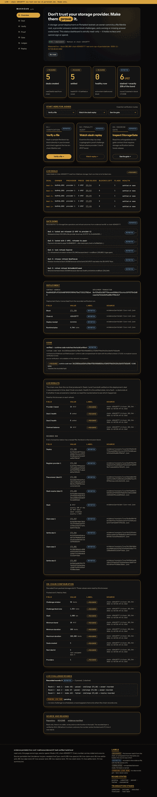
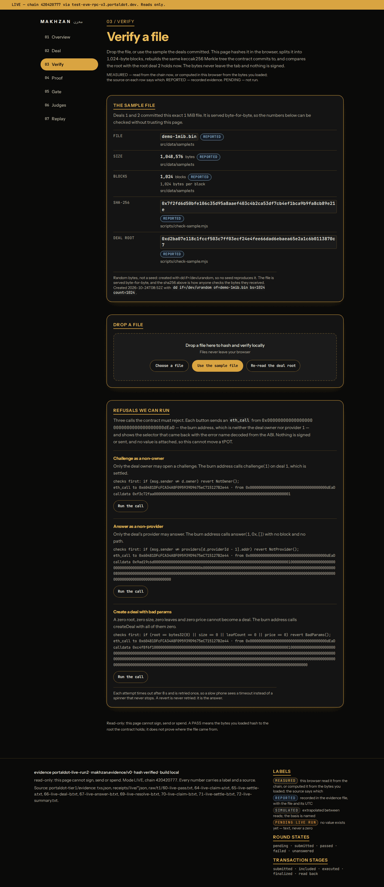
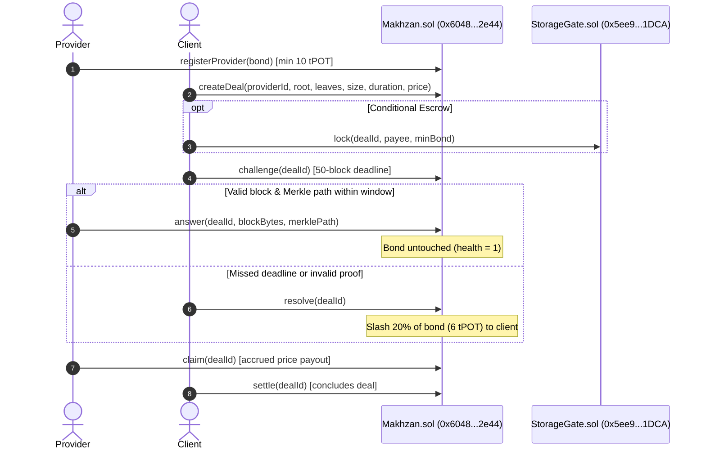
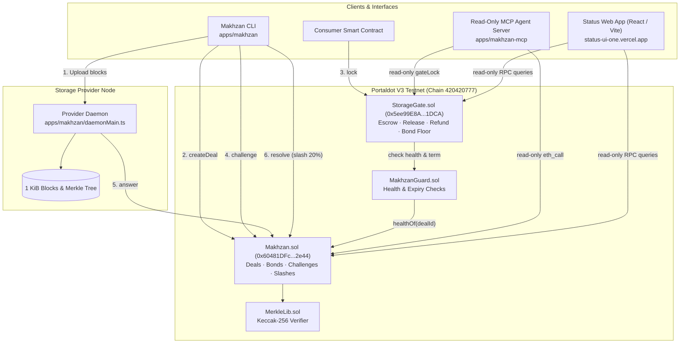

# Makhzan

Bonded, challenge-verified storage on Portaldot: a provider locks a tPOT bond, and if it cannot prove it still holds a randomly chosen 1 KiB block of the client's file, 20% of the bond is paid to the client.

**Status:** Live on Portaldot V3 testnet, chain 420420777 · **889 tests** (208 contracts · 355 UI · 181 CLI · 68 MCP · 49 gates · 28 scripts) · **6 live deals** (5 settled, 1 healthy until about Nov 11) · **20% slash** (6 tPOT)

[Try It in 60s](#try-it-in-60-seconds) · [Screenshots](#screenshots) · [Problem & Solution](#problem-and-solution) · [How It Works](#how-it-works) · [Live Results](#live-results) · [Live Gate Demo](#live-gate-demo) · [Verify It Yourself](#verify-it-yourself) · [Consumer Layer](#consumer-layer) · [Why Portaldot V3](#why-portaldot-v3) · [Quickstart](#quickstart) · [Security & Limits](#security-and-honest-limits) · [Economics & Project Info](#economics)

---

## Try it in 60 seconds

- **Status Web App (Live):** [status-ui-one.vercel.app](https://status-ui-one.vercel.app/)
- **Verify in Browser (`/verify`):** [status-ui-one.vercel.app/verify](https://status-ui-one.vercel.app/verify) — recompute 1 MiB Merkle root against live deal 2; flip 1 byte to reject.
- **For Judges (`/judges`):** [status-ui-one.vercel.app/judges](https://status-ui-one.vercel.app/judges) — direct verification index, contract facts, and proof hashes.
- **Makhzan Core:** [`0x60481DFcFCA34A8F095939D9675eC715127B2e44`](https://pindex.onrender.com/app/?q=0x60481DFcFCA34A8F095939D9675eC715127B2e44) *(third-party lookup: Pindex)*
- **StorageGate:** [`0x5ee99E8AE165d0C33677C812d70B0b07820c1DCA`](https://pindex.onrender.com/app/?q=0x5ee99E8AE165d0C33677C812d70B0b07820c1DCA) *(third-party lookup: Pindex)*

## Screenshots

| Live Deals Overview (`/`) | In-Browser Merkle Verification (`/verify`) |
| :---: | :---: |
|  |  |

## Problem and solution

1. Off-chain storage protocols offer invoices and uptime dashboards, but clients have no way to audit custody or punish missing data on-chain.
2. A provider can claim to store data while holding nothing, and today there is no cheap way to check without trusting them or downloading everything.
3. Makhzan turns storage promises into cryptographic commitments by dividing files into 1 KiB leaves committed under an on-chain Merkle root.
4. Storage providers stake a native tPOT bond that is held directly at risk throughout the deal's duration.
5. If a provider fails to produce a challenged 1 KiB block and its Merkle path within 50 blocks (300 s), exactly 20% of the bond is slashed on-chain and credited to the client.

## How it works





## Live results

6 deals created on Portaldot V3 testnet (`chain 420420777`): 5 settled, 1 healthy until about Nov 11 (`evidence/raw/t10/03-deal6-summary.md`). Core deployment: Makhzan `0x60481DFcFCA34A8F095939D9675eC715127B2e44` deployed by `0x0948EBD7637D1C32858a6FC5D947E85A6600205C` (tx `0xf29a52c507726ceed20861f2cc4cc5f937542d0caa42a7e2a369ea08c998e3e7`, block `171308` with hash `0x5a301c5d1b4ebaa818c0a6aa03fda46ba6829017275d58e45ca4885d1f654a98`, finalized block `171311`, total cost `529.844316817465986480 tPOT`, reserved deposit `165.513 tPOT`, owner balance after `199.435042290680279745 tPOT`). StorageGate: `0x5ee99E8AE165d0C33677C812d70B0b07820c1DCA` (tx `0x5a0f5719c447cfa771221872bcd7935f74fecedf046dc7b14acb40031b0a25a7`, block `240956`, cost `210.575612711692978125 tPOT`).

<details>
<summary><strong>Core Protocol Lifecycle: Deals 1, 2 & 6 [live run] (Click to expand)</strong></summary>

| Step | Action | Tx Hash | Block | Result / Measured Numbers | Evidence Path |
| :--- | :--- | :--- | :--- | :--- | :--- |
| Deploy | Deploy Makhzan | `0xf29a52c507726ceed20861f2cc4cc5f937542d0caa42a7e2a369ea08c998e3e7` | `171308` | Cost 529.844316817465986480 tPOT, runtime 6,566 B | `evidence/raw/t1/59-live-deploy.txt` |
| Reg | Register Provider-1 | `0xd579567999dab3e34f5c6858eebff651b5d497d39995b47cabedd601a7d9cb91` | `172240` | Bond 30 tPOT locked (fee 11.537715 tPOT) | `evidence/raw/t1/62-live-register.txt` |
| Deal 1 | createDeal (1 MiB) | `0x44c41e75c8e6d8a70620f07c56a6bd2a721cc6c45d0b98a314190767276c09b1` | `172266` | 1,024 leaves, price 5 tPOT, duration 150 blocks | `evidence/raw/t1/60-live-pass.txt` |
| Deal 1 | challenge #1 | `0x02686f6ff22cd0f4a905b489a30bd45b1c481229cb2830ae0467dbee072ffcda` | `172281` | Leaf index 451, deadline 172331 | `evidence/raw/t1/60-live-pass.txt` |
| Deal 1 | answer #1 | `0x8da1f12d9db85123e4ea3a13c8e2aa57b373981a6b6df66c57ec153cea9ce8e3` | `172295` | Valid proof; bond remains 30 tPOT (health = 1) | `evidence/raw/t1/60-live-pass.txt` |
| Deal 1 | claim | `0x48a306f40b67302ff3c274e2b6e1ad74f721fb9ca426a7274df10e057378415b` | `172557` | Provider-1 paid 5 tPOT accrued price | `evidence/raw/t1/64-live-claim-a.txt` |
| Deal 1 | settle | `0x312534d44d26dccee8f11b790d0a013cd9631e642e38efe8c7a31d39d18d3af3` | `172564` | Concluded; healthOf(1) = 0 | `evidence/raw/t1/65-live-settle-a.txt` |
| Deal 2 | createDeal (1 MiB) | `0xc6cd7a3ce372535c8a769feb8addbe328e17fb179156ac53d7a8c732acb1a0d3` | `172578` | 1,024 leaves, price 5 tPOT, duration 300 blocks | `evidence/raw/t1/66-live-deal-b.txt` |
| Deal 2 | challenge #1 | `0xd2d8445b0671aa3d0c307ce54c1fb251bc6cd08b7d72a3f291ca7497c0d65cdb` | `172584` | Leaf index 29, deadline 172634 | `evidence/raw/t1/67-live-answer-b.txt` |
| Deal 2 | answer #1 | `0xb1ddb1fb54e6f4c4405cfcb85640cae51808ef6ce7509f0e14acc422c3621210` | `172585` | Valid proof; bond unchanged | `evidence/raw/t1/67-live-answer-b.txt` |
| Deal 2 | challenge #2 | `0x510df3134ce6dff37155d72237b6e4da09538f139621079b22efe227d677f4db` | `172602` | Leaf index 623, deadline 172652; skipped by daemon | `evidence/raw/t1/68-live-skip-b.txt` |
| Deal 2 | resolve (slash) | `0x97da004710a5e01ea97b9d602f5b8ef5c5382ea5800c5d52b02951cb6809e8a3` | `172658` | Exactly 20% (6 tPOT) slashed to owner; bond: 30 -> 24 | `evidence/raw/t1/69-live-resolve-b.txt` |
| Deal 2 | claim | `0x128bfd86661cd988e103153f82753a92b01650a7774228be8ee831163dff36ee` | `172881` | Provider-1 paid 5 tPOT accrued price | `evidence/raw/t1/70-live-claim-b.txt` |
| Deal 2 | settle | `0x59d61ee8b330c37576b9245731d2ab3ebac28d07faf03148f6eff5388dc2bbec` | `172887` | Concluded; healthOf(2) = 0 | `evidence/raw/t1/71-live-settle-b.txt` |
| Deal 6 | createDeal (1 MiB, 7-day) | `0x1fc238c44224a861b5e6456813396272ab470930c518a338c734283b1003abd1` | `318035` | 1,024 leaves, price 5 tPOT, duration 100,800 blocks (endBlock 418835); total cost 16.557011868111074750 tPOT (fee 11.557011868111074750 tPOT); active healthy (healthOf = 1) until about Nov 11 | `evidence/raw/t10/03-deal6-summary.md` |
| Native Anchor 1 | `TransactionStorage.store` (manifest 283 B) | Extrinsic hash: `0x622262a662fc517b957a4da35912637109b7e5c07c35a008964a61292ba106fc` · Block hash: `0x9106e229f61f6ef793fc0c15cc9719e849b07e4b56ca37651e92fd28b80c8d39` | `333185` | Manifest 283 B anchored; fee 0.039405 tPOT; chunkRoot `0xea74ca619064ac9e1509ff7e00d1ec9b63d301d5ff76dae618c2ec73163e8cb1`; retention 100,800 blocks (expires about 2026-11-12T10:06:48Z) | `evidence/raw/t11/03-anchor-summary.md` |
| Native Anchor 2 | `TransactionStorage.store` (duplicate submit) | Extrinsic hash: `0xad209e843ec732f72031cf0e971a6486509a3f72b9767879abbcefb2d897d354` · Block hash: `0x4663aea7b2a8718895f4e38e8b02987a528ac76176b28dc6f0483b2749493685` | `333189` | Duplicate submit of identical 283 B manifest; fee 0.039405 tPOT; chunkRoot `0xea74ca619064ac9e1509ff7e00d1ec9b63d301d5ff76dae618c2ec73163e8cb1`; retention 100,800 blocks (expires about 2026-11-12T10:07:12Z) | `evidence/raw/t11/03-anchor-summary.md` |

</details>

## Live gate demo

Exercised `StorageGate` across 13 broadcast transactions with total fees of **`50.205185 tPOT`** (out of an 80 tPOT budget cap), ending with Owner balance at `195.509586 tPOT`, Provider-1 balance at `44.932150 tPOT`, and gate balance returned to 0 tPOT (`evidence/raw/t8/gate-demo-summary.md`):

<details>
<summary><strong>StorageGate Demo: Deals 3, 4, 5 (Click to expand)</strong></summary>

| Step | Action | Tx Hash or Refusal | Block | Result |
| :--- | :--- | :--- | :--- | :--- |
| 1 | `createDeal(3)` | `0x196d1ab6b059441ad92a17e83d98b5da2f8fa8c223ed6f79a42df238284689ee` | `250092` | Deal 3 created (term 500, endBlock 250692) |
| 2 | `gate lock 3` | *refused pre-broadcast* (`Expired`) | `251940` | Block 251940 > endBlock 250692 (0 gas) |
| 3 | `createDeal(4)` | `0x853225285c317dc91de4ecc9aee61be950fad7801ea64fcf25d79710d1104761` | `252512` | Deal 4 created (term 3,000) |
| 4 | `gate lock 4` | `0x3719248237ec37c916b11e3d014aebba05d84cedcdcdc79cc1b9feaa18a62203` | `252523` | Lock 4 opened; 2 tPOT deposited (minBond 20 tPOT) |
| 5 | `gate release 4` | `0x4c63d339e7db1cfa9ef7b48194d38f6b2c2613f60d6cf0d3d3c6afbbc6d35c3f` | `252535` | Provider-1 paid +2 tPOT (fee 0.015322 tPOT); status = released |
| 6 | `createDeal(5)` | `0x12557be0d42359a70cbb22acd05310efff94c1bd19223c7d524e8c59400662be` | `252544` | Deal 5 created (term 3,000) |
| 7 | `gate lock 5` | `0xf84af2e383b8239c350a16bdf074a14925cd954cacd3ca25ec1621a5fcf869db` | `252552` | Lock 5 opened; 2 tPOT deposited (minBond 30 tPOT) |
| 8 | `gate release 5` | *refused pre-broadcast* (`BondTooLow`) | `252560` | Bond 24 < minBond 30 tPOT (0 gas) |
| 9 | `gate refund 5` | *refused pre-broadcast* (`RefundNotAllowed`) | `252564` | In-term and healthy (0 gas) |
| 10 | `claim(3)` | `0x9c8ec1c10b2f57ffa90ed22c09db49b019e26b7656825df3bd764bad46505441` | `258836` | Deal 3 claimed by Provider-1 (+5 tPOT, fee 0.015313 tPOT) |
| 11 | `settle(3)` | `0x57d35092a6f16989ae26a59fa35acec60179aac043bbf247f2ecf54c32d8e064` | `258844` | Deal 3 settled by Owner (fee 0.015312 tPOT) |
| 12 | `gate refund 5` | `0x11adf58b7d5071d486e185b4485c380878768ee05c508331cd6a07c7b8347a23` | `264442` | Post-term refund: +2 tPOT back to Owner (fee 0.015317 tPOT) |
| 13 | `claim(4)` | `0x491fdf174810101c7e96915604d78cc6c0e12bcdb1ef7d810adb264382ca1846` | `264450` | Deal 4 claimed (+5 tPOT, fee 0.015313 tPOT) |
| 14 | `claim(5)` | `0x0bda52e6038d9955293ffbb2b78935638659696e4e5a1dd905809d6ee2134745` | `264458` | Deal 5 claimed (+5 tPOT, fee 0.015313 tPOT) |
| 15 | `settle(4)` | `0x5a156d435057ddbeb9de0ca9b4cd48155dbf63391af0fca7cfd76231c4448279` | `264469` | Deal 4 settled by Owner (fee 0.015312 tPOT) |
| 16 | `settle(5)` | `0x54c71257ed6f82b5ba6cbd0983ea1b99b300fe705c2eed1abecab6bad719fc34` | `264477` | Deal 5 settled by Owner (fee 0.015312 tPOT) |

</details>

*Honest operational notes:*
1. Guard checks expiry before the bond floor in `MakhzanGuard.requireHealthy`.
2. A released lock stays released (status 2 and 3 are terminal).
3. Display-unit bug fixed in UI (`0f5e93e`) and MCP server (`1f4b029`).

## Verify it yourself

All commands are 100% read-only (no private key, 0 gas, public EVM RPC):

```bash
# 1. Audit Deal 1 on-chain verification (7 checks)
cd apps/makhzan
MAKHZAN_NETWORK=live MAKHZAN_RPC_URL=https://test-evm-rpc-v3.portaldot.dev MAKHZAN_CHAIN_ID=420420777 MAKHZAN_CONTRACT=0x60481DFcFCA34A8F095939D9675eC715127B2e44 node src/cliMain.ts verify 1
# Expected: RESULT: PASS (7 pass, 0 fail, 0 unknown, 0 pending)

# 2. Audit Deal 2 challenge pass & 20% slash (9 checks)
MAKHZAN_NETWORK=live MAKHZAN_RPC_URL=https://test-evm-rpc-v3.portaldot.dev MAKHZAN_CHAIN_ID=420420777 MAKHZAN_CONTRACT=0x60481DFcFCA34A8F095939D9675eC715127B2e44 node src/cliMain.ts verify 2
# Expected: RESULT: PASS (9 pass, 0 fail, 0 unknown, 0 pending) — 600000000000000 units slashed to owner

# 3. Check live StorageGate lock 4 state (released to Provider-1)
MAKHZAN_NETWORK=live MAKHZAN_RPC_URL=https://test-evm-rpc-v3.portaldot.dev MAKHZAN_CHAIN_ID=420420777 MAKHZAN_CONTRACT=0x60481DFcFCA34A8F095939D9675eC715127B2e44 MAKHZAN_GATE=0x5ee99E8AE165d0C33677C812d70B0b07820c1DCA node src/cliMain.ts gate status 4
# Expected: "status": 2, "statusName": "released", "amountTpot": "2.000000", "minBondTpot": "20.000000"

# 4. Check live StorageGate lock 5 state (refunded to Owner)
MAKHZAN_NETWORK=live MAKHZAN_RPC_URL=https://test-evm-rpc-v3.portaldot.dev MAKHZAN_CHAIN_ID=420420777 MAKHZAN_CONTRACT=0x60481DFcFCA34A8F095939D9675eC715127B2e44 MAKHZAN_GATE=0x5ee99E8AE165d0C33677C812d70B0b07820c1DCA node src/cliMain.ts gate status 5
# Expected: "status": 3, "statusName": "refunded", "amountTpot": "2.000000", "minBondTpot": "30.000000"

# 5. Read Makhzan healthOf(1) via cast (0 = settled)
cast call 0x60481DFcFCA34A8F095939D9675eC715127B2e44 "healthOf(uint32)" 1 --rpc-url https://test-evm-rpc-v3.portaldot.dev
# Expected: 0x0000000000000000000000000000000000000000000000000000000000000000

# 6. Read StorageGate lockOf(4) raw slot via cast
cast call 0x5ee99E8AE165d0C33677C812d70B0b07820c1DCA "lockOf(uint32)" 4 --rpc-url https://test-evm-rpc-v3.portaldot.dev
# Expected: payer 0x0948...205c, amount 2 tPOT (0x1bc16d674ec80000 wei), payee 0xf4ec...6029, minBond 20 tPOT, status 2

# 7. Read Makhzan healthOf(6) via cast (1 = healthy active deal)
cast call 0x60481DFcFCA34A8F095939D9675eC715127B2e44 "healthOf(uint32)" 6 --rpc-url https://test-evm-rpc-v3.portaldot.dev
# Expected: 0x0000000000000000000000000000000000000000000000000000000000000001

# 8. Inspect native TransactionStorage anchor 1 (manifest 283 B in block 333185)
# In browser: https://node-console.portaldot.dev/?rpc=wss%3A%2F%2Ftest-node-v3.portaldot.dev#/explorer/query/333185
# Or read back storage state via @polkadot/api from apps/gates:
cd apps/gates && node -e '
import { ApiPromise, WsProvider } from "@polkadot/api";
const api = await ApiPromise.create({ provider: new WsProvider("wss://test-node-v3.portaldot.dev"), noInitWarn: true });
const txs = await api.query.transactionStorage.transactions(333185);
console.log(JSON.stringify(txs.toJSON()));
await api.disconnect();
'
# Expected: [{"chunkRoot":"0xea74ca619064ac9e1509ff7e00d1ec9b63d301d5ff76dae618c2ec73163e8cb1","contentHash":"0x62cc9db432d5b3b553565f0d5e05b0312e4244d7ab424b9188ae18e62c8b39eb","size":283,"blockChunks":2}]
```

## Consumer layer

`StorageGate.sol` ([`0x5ee99E8AE165d0C33677C812d70B0b07820c1DCA`](https://pindex.onrender.com/app/?q=0x5ee99E8AE165d0C33677C812d70B0b07820c1DCA)) provides conditional escrow for contracts paying storage providers:
- **`lock(dealId, payee, minBond)`**: deposits payer tPOT; requires healthy deal.
- **`release(dealId)`**: payee-only; requires `MakhzanGuard.requireHealthy` and provider bond >= `minBond`.
- **`refund(dealId)`**: payer-only; allowed if defaulted (`healthOf == 3`) or term elapsed (`block.number >= endBlock`).

**Read-only MCP Agent Server (`apps/makhzan-mcp`):** Exposes 4 keyless tools over standard stdio JSON-RPC:
1. `makhzan_health(dealId)`: returns `healthOf`, block status, and guard verdict.
2. `makhzan_verify_file(dealId, path)`: checks local file Merkle tree against on-chain root (sandboxed).
3. `makhzan_deal_story(dealId)`: chronological reconstruction of deal lifecycle events.
4. `makhzan_gate_status(dealId)`: inspects escrow lock status, payee, and release readiness.

## Why Portaldot V3

- **EVM via `pallet-revive`:** standard Solidity (`solc 0.8.28`, `via_ir=true`), deployed directly over `eth_sendRawTransaction`.
- **Native Value & Unit Factor:** deal prices and bonds use native units (`1 tPOT = 10^14 planck`); `WEI_PER_UNIT = 10,000` (`1 tPOT = 10^18 wei`). Existential deposit = 0.1 tPOT (`10^17 wei`). Native dry-run store of 1 MiB quoted `104.86915567090586 tPOT` and 4 MiB quoted `419.44210364626048 tPOT`; runtime deposit is `0.0807 tPOT` per byte.
- **Account Mapping:** H160 mapped to Substrate `AccountId32` via `h160 || 0xEE * 12` (contract maps to `5EEwsqgiEVZNUdUHdmsEMqBQzJjNy5PULPBYoo5yF2GX45DZ`).
- **Native TransactionStorage Anchoring:** First live use of Substrate's `TransactionStorage` pallet on Portaldot V3 testnet (`evidence/raw/t11/03-anchor-summary.md`). Deal 6 manifest (283 B) anchored in block `333185` (extrinsic hash `0x622262a662fc517b957a4da35912637109b7e5c07c35a008964a61292ba106fc`, block hash `0x9106e229f61f6ef793fc0c15cc9719e849b07e4b56ca37651e92fd28b80c8d39`) for a fee of `0.039405 tPOT` (duplicate anchor 2 in block `333189`, extrinsic hash `0xad209e843ec732f72031cf0e971a6486509a3f72b9767879abbcefb2d897d354`, block hash `0x4663aea7b2a8718895f4e38e8b02987a528ac76176b28dc6f0483b2749493685`). Storage is temporary with a 100,800 block retention period (~7 days; Anchor 1 expires about `2026-11-12T10:06:48Z`).
- **Chain Gotchas Guide ([docs/V3-GOTCHAS.md](docs/V3-GOTCHAS.md)):** 12 measured findings including gas price bands (~32.5k wei), 15 s receipt trap (T1-002), permanent non-refundable storage deposits, and the constant `prevrandao` opcode observation.

## Quickstart

**Prerequisites:** Node.js 24, Foundry 1.8.5 (`forge`, `anvil`, `cast`), git.

```bash
git clone https://github.com/MohammedSoliman10/portaldot-hackathon-2026-makhzan-soliman.git
cd portaldot-hackathon-2026-makhzan-soliman
git submodule update --init --recursive

# 1. Run Contract Suites (208 tests)
cd contracts && forge build --sizes && forge test && cd ..

# 2. Run Client & Daemon Tests (181 tests)
cd apps/makhzan && npm ci && npm test && cd ../..

# 3. Run MCP Agent Server Tests (68 tests)
cd apps/makhzan-mcp && npm ci && npm test && cd ../..

# 4. Run Status Web UI locally (355 tests)
cd apps/status-ui && npm ci && npm test && npm run dev
```

### Repository & Documentation Map

| Directory | Purpose | Document | Focus |
| :--- | :--- | :--- | :--- |
| `contracts/` | Solidity contracts (Makhzan, StorageGate, MerkleLib) | [docs/architecture.md](docs/architecture.md) | Component diagrams & lifecycle sequences |
| `apps/makhzan/` | Client CLI, provider daemon, verification scripts | [docs/THREAT_MODEL.md](docs/THREAT_MODEL.md) | Threat boundaries, assets & invariants |
| `apps/makhzan-mcp/` | Read-only MCP agent server (4 tools) | [docs/BUSINESS.md](docs/BUSINESS.md) | Economic models, costs & sensitivity |
| `apps/status-ui/` | React / Vite black-and-gold status web app | [docs/V3-GOTCHAS.md](docs/V3-GOTCHAS.md) | 12 live-measured Portaldot V3 facts |
| `evidence/` | Raw transaction receipts, deploy records & logs | [docs/REPRODUCE.md](docs/REPRODUCE.md) | Step-by-step reproduction runbook |

## Security and honest limits

See [docs/THREAT_MODEL.md](docs/THREAT_MODEL.md) for full analysis:
- **One block at one moment:** A passed challenge proves possession of one 1 KiB block during the window, not continuous disk storage.
- **Only the deal owner can challenge:** `challenge(dealId)` restricts caller to `deal.owner`; a third party cannot challenge a bad provider, and only the deal owner is paid from the slashed bond.
- **Challenge index & entropy:** Derived via the fallback selector (`keccak256(blockhash(n-1), prevrandao, dealId) % leafCount`). While Discord confirmed YES to `block.prevrandao`, our read-only audit measured `mixHash` as constant `0x8e1bc9bf04000` across 37 blocks (and opcode `0x44` dry-runs return the same constant). Thus, randomness relies on the parent blockhash and deal ID: unpredictable before block creation, but not VRF-grade and biasable by block producers.
- **Fixed challenge window:** The 50-block window (~300 s at 6 s blocks) is a deployed constant. About 6 rounds fit a 300-block demo deal; real deals get 288 rounds per day.
- **Health semantics & gate visibility:** `healthOf == 1` means "no open challenge", not "file stored". The gate sees current state only; once a default is resolved, `healthOf` returns to 1, and `minBond` is how it notices a past slash.
- **Demo pricing:** The 5 tPOT price is a demo value, not a tariff. It was set to make the live runs legible, not from market economics.
- **Guarded CLI & simulation:** The live gate demo used guarded CLI commands (`apps/makhzan`); the 3 refusals (`Expired`, `BondTooLow`, `RefundNotAllowed`) were shown by `eth_call` pre-broadcast simulation with 0 gas spent.
- **Identical blocks:** Leaf commits bytes without position; identical blocks share proofs.
- **Shared bond ceiling:** One provider bond backs all deals under management.
- **Same-transaction gate check:** `StorageGate` reads health at execution; later slashes cannot retroactively undo a release.
- **Audit status:** No formal security audit; no live explorer source verification.

## Economics

- **Measured transaction costs (at ~32.5k wei gas price):** Makhzan deploy `529.844316817465986480 tPOT` (`165.513 tPOT` reserved deposit + execution), StorageGate deploy `210.575612711692978125 tPOT`, deal create `11.557014 tPOT`, register provider `11.537715 tPOT`, gate lock `7.705815 tPOT`, challenge `0.0153 tPOT`, answer `0.1629 tPOT`, resolve/slash `0.0153 tPOT`. Full analysis in [docs/BUSINESS.md](docs/BUSINESS.md).
- **Roadmap (unbuilt):** Independent third-party provider pilot, day-scale deals (288 rounds/day), VRF/native randomness beacon integration, parameterised bond scaling v2, and write-capable agent client.
- **Team:** Mohammed Soliman (solo builder).

## Built with AI assistance

This project was built with AI assistance across all development stages, with human engineering direction, architecture specification, review, and verification. AI-assisted commits carry `[ai]` in their commit messages (over 400 commits). Tooling: opencode + Spec Kit for scaffolding, Google Antigravity (Claude and Gemini models) for implementation, testing, UI polish, and live audit.

## Third-party software

See [THIRD-PARTY.md](THIRD-PARTY.md) for package manifests and versions. Key tools: Spec Kit (v1.2.2, MIT), Foundry (1.8.5, MIT/Apache-2.0), viem (2.57.7, MIT), @modelcontextprotocol/sdk (1.32.2, MIT), React (19.2.9, MIT), Tailwind CSS (4.1.14, MIT), Vite (7.3.7, MIT).

## Licence

MIT. See [LICENSE](LICENSE).
