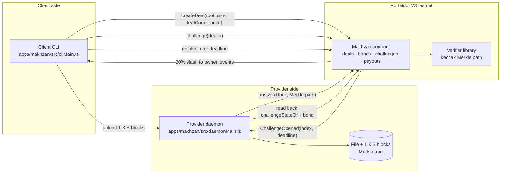

# Makhzan

**Bonded, challenge-verified storage on Portaldot: a provider stakes tPOT, and a client can prove a
missing block and be paid from the bond.**

- Repository: https://github.com/MohammedSoliman10/portaldot-hackathon-2026-makhzan-soliman
- Live contract (Portaldot V3 testnet, chain `420420777`): `0x60481DFcFCA34A8F095939D9675eC715127B2e44`
- Status: **full live run complete [live run]**: contract deployed, provider-1 registered, deal A
  passed and was claimed/settled, deal B passed with the fixed daemon, then a skipped second challenge
  was resolved with exactly 20% slashed to the owner, and deal B was claimed/settled. The first live
  pass exposed daemon defect T1-002 (a 15 s receipt wait mislabelled a landed answer); it is fixed and
  the re-run is clean. A fresh read-only client then retrieved the 1 MiB file as 1,024 blocks, verified
  every block against the on-chain root, and reproduced the upload sha256; a tampered copy was rejected.
  Everything not marked `[live run]` is local evidence.

## The problem

A storage deal is a promise about bytes the client cannot see. Today the client either trusts the
provider or pays for a full audit. Settling "did you really keep block 7?" on-chain needs four things:
a compact commitment to the file, a bounded window to ask, a verifiable answer, and a penalty that
actually pays the wronged client. Makhzan implements those four pieces with a small contract and a
CLI/daemon pair.

## How it works, in plain words

1. **Commit.** The client splits the file into fixed **1 KiB blocks**, builds a Merkle tree, and calls
   `createDeal(providerId, root, leafCount, size, durationBlocks, price)` with the price in native
   tPOT. The root and the size are on-chain; the bytes stay with the provider.
2. **Bond.** A provider registers with a bond (`registerProvider`, at least `minBond`). The bond is
   the money at risk; the same bond backs every deal that provider holds.
3. **Challenge.** Within the deal's life the client can open one challenge per deal. The contract
   picks a leaf index from `keccak256(blockhash(block.number - 1), prevrandao, dealId) % leafCount`
   and stores a **50-block deadline**.
4. **Answer.** The provider daemon rebuilds the Merkle path for that block and submits the 1 KiB block
   plus the path. The contract recomputes the root and checks the index, the path length and the
   bytes. A correct answer closes the challenge with **no bond movement**.
5. **Slash.** If the deadline passes without an answer, anyone may call `resolve`. Exactly
   **`slashBps` (2,000 bps = 20%) of the bond** is slashed and credited to the deal owner in
   `WEI_PER_UNIT` accounting. A late or wrong answer cannot rescue the round.
6. **Pay.** After the end block, the provider calls `claim` to take its accrued price (claim is
   provider-only and does **not** move the bond), then the owner calls `settle` to release the deal.
   `healthOf(dealId)` exposes `0` unknown/settled, `1` healthy, `2` challenge pending, `3` in default
   so other contracts can gate on availability without decoding storage.

The daemon never trusts its own tx hash: after sending it re-reads `challengeStateOf` and the provider
bond, and only then labels the round `passed` or `failed`.

## Portaldot V3 features used

- **EVM via pallet-revive.** The contract is ordinary Solidity (`solc`, `via_ir = true`), deployed as
  EVM bytecode to the Portaldot V3 testnet over `eth_sendRawTransaction`. The live `eth_estimateGas`
  and the deploy transaction both accepted the IR bytecode.
- **Native tPOT value with the 10,000 wei unit factor.** Deal price and bond are stored in **native
  units**; `msg.value = units × 10,000 wei`. The factor `WEI_PER_UNIT = 10_000` was confirmed on the
  live chain in Tier 0 and is used unchanged in the contract, CLI and deploy script.
- **Account mapping.** The same H160 is mapped to a Substrate account on Portaldot. The deployed
  contract address `0x60481D…2e44` maps to `5EEwsqgiEVZNUdUHdmsEMqBQzJjNy5PULPBYoo5yF2GX45DZ`
  (read from the Pindex API). Keys stay in the environment; the wrapper never prints or stores one.

## Deployment — Portaldot V3 testnet `[live run]`

| Field | Value |
| --- | --- |
| Chain id | `420420777` |
| RPC | `https://test-evm-rpc-v3.portaldot.dev` |
| Contract | `0x60481DFcFCA34A8F095939D9675eC715127B2e44` |
| Deployer | `0x0948EBD7637D1C32858a6FC5D947E85A6600205C` |
| Deploy tx | `0xf29a52c507726ceed20861f2cc4cc5f937542d0caa42a7e2a369ea08c998e3e7` |
| Block | `171308` (finalized block `171311` observed afterwards) |
| Status / gas | `success` / `16262870374998956` gas, effective price `32580` wei |
| Estimate → measured | `538.123540 tPOT` → `529.844316817465986480 tPOT` |
| Ratio vs calibration | `0.9846146412530473` vs Tier 0 `0.984608251872` (+0.00065%) |
| Owner balance after | `199.435042290680279745 tPOT` (100 tPOT reserve intact) |
| Runtime / creation | `6,566 B` / `7,154 B` (budget `10,240 B`) |
| Runtime code hash | `0x115036eac836fca78bef7824fb0d0834ccf3d9d7f9663fe154c36e91f7d26a98` |
| `verify:deployment` | **match**, 6,566 B runtime = 6,566 B artifact, `firstDiff: null` |
| Config read back | window `50`, block size `1024`, slash `2000 bps`, min bond `1e15 units` (`1e19` wei), duration `100…100800` |

**Explorer.** The only confirmed deep link is the Pindex address route:
<https://pindex.onrender.com/app/?q=0x60481DFcFCA34A8F095939D9675eC715127B2e44> (the page performs
the lookup client-side; the API returns the mapped account). Pindex **does not have a confirmed
transaction-hash route** — its 64-hex search treats the value as a block hash — so search the address
above or block **`171308`**. The official node console <https://node-console.portaldot.dev/> has no
confirmed deep-link format; open it and search the same address or block. The tx hash is shown as plain
text above; no URL pattern is invented.

**Evidence** (all committed):

- `evidence/raw/t1/59-live-deploy.txt` — deploy facts, measured drop, ratio, config read-back
- `evidence/deployments/live-420420777-20261024-065714Z.json` — deployment record
- `evidence/receipts/live/0xf29a52c507726ceed20861f2cc4cc5f937542d0caa42a7e2a369ea08c998e3e7.json` — raw receipt
- `evidence/verify-deployment.json` — byte-for-byte code verification
- `evidence/raw/t1/58-live-gate.txt`, `59-doctor-after-deploy.txt`, `59-pending-{sending,sent}.json`
- Tier 0 calibration: `evidence/calibration.json` (ratio `0.984608251872`)

**Live run [live run].** Provider-1 registered with a 30 tPOT bond (tx
`0xd579567999dab3e34f5c6858eebff651b5d497d39995b47cabedd601a7d9cb91`), deal A was created at block
`172266` (tx `0x44c41e75c8e6d8a70620f07c56a6bd2a721cc6c45d0b98a314190767276c09b1`), challenge 1
opened at index `451` (tx `0x02686f6ff22cd0f4a905b489a30bd45b1c481229cb2830ae0467dbee072ffcda`), and
the daemon's answer landed at block `172295` (tx
`0x8da1f12d9db85123e4ea3a13c8e2aa57b373981a6b6df66c57ec153cea9ce8e3`) before the `172331`
deadline. On-chain the round passed: `healthOf(1) = 1`, the bond stayed at 30 tPOT.

That first pass exposed T1-002: the daemon's 15 s receipt wait timed out before the answer was mined,
it had not persisted the hash, and it labelled the closed round `unanswered`. The fix persists the
hash before any wait, uses a receipt timeout of at least 120 s (600 s in the live rerun), and keeps a
timed-out round `submitted` until a later receipt and read-back resolve it.

After the fix the full live path ran:

- **Deal A close.** Claim tx `0x48a306f40b67302ff3c274e2b6e1ad74f721fb9ca426a7274df10e057378415b`
  (block `172557`) paid the provider the full 5 tPOT; settle tx
  `0x312534d44d26dccee8f11b790d0a013cd9631e642e38efe8c7a31d39d18d3af3` (block `172564`) set health
  to `0`; the bond did not move.
- **Deal B pass.** Deal 2 was created at block `172578` (tx
  `0xc6cd7a3ce372535c8a769feb8addbe328e17fb179156ac53d7a8c732acb1a0d3`, end `172878`). Challenge
  index `29` (tx `0xd2d8445b0671aa3d0c307ce54c1fb251bc6cd08b7d72a3f291ca7497c0d65cdb`, block
  `172584`) was answered at block `172585` (tx
  `0xb1ddb1fb54e6f4c4405cfcb85640cae51808ef6ce7509f0e14acc422c3621210`). The daemon state became
  `passed` only after the receipt and read-back; `healthOf(2) = 1` and the bond did not move. The
  raw answer receipt is in `txs.json`.
- **Deal B slash.** A second challenge, index `623` (tx
  `0x510df3134ce6dff37155d72237b6e4da09538f139621079b22efe227d677f4db`, block `172602`,
  deadline `172652`), was left unanswered by the skip-mode daemon: health was `2` during the window
  and `3` after it. Resolve tx
  `0x97da004710a5e01ea97b9d602f5b8ef5c5382ea5800c5d52b02951cb6809e8a3` (block `172658`) slashed
  exactly 6 tPOT (30 -> 24 tPOT, 20%) and credited the owner exactly 6 tPOT. The daemon labelled the
  round `failed`.
- **Deal B close.** Claim tx
  `0x128bfd86661cd988e103153f82753a92b01650a7774228be8ee831163dff36ee` (block `172881`) paid the
  provider 5 tPOT; settle tx
  `0x59d61ee8b330c37576b9245731d2ab3ebac28d07faf03148f6eff5388dc2bbec` (block `172887`) set health
  to `0`; the remaining bond stayed at 24 tPOT.
- **Refusals.** Free `eth_call` checks returned the custom selectors `0x30cd7471` (NotOwner),
  `0x3480e2b2` (NotProvider) and `0x019af637` (BadParams), so R2 is yes.

Final measured balances: owner `172229122908433355700` wei, provider-1
`27993410962002459140` wei, provider bond `2400000000000000` units. Evidence:
`evidence/raw/t1/60-live-pass.txt`, `62-live-register.txt`, `63-live-refusals.txt`,
`64-live-claim-a.txt` through `72-live-summary.txt`, plus the raw receipts under
`evidence/receipts/live/`.

## Architecture



The full component and sequence views are in [docs/architecture.md](docs/architecture.md).

## Implemented / simulated / roadmap

| Capability | State | Evidence |
| --- | --- | --- |
| Merkle block commitment shared by Solidity and TypeScript (golden vectors, leaf counts 1, 3, 7, 1000) | implemented, local | `evidence/raw/t1/05-vectors.txt`, `11-ts-merkle-green.txt` |
| Provider registry, minimum bond, packed slot layout | implemented, local | `evidence/raw/t1/17-registry-green.txt`, `21-slots-green.txt` |
| Deals: root, size, leaf count, price escrow, duration | implemented, local | `evidence/raw/t1/19-deals-green.txt`, `22-us1-independent.txt` |
| Challenge index from the D5 fallback, deadline, expected path length | implemented, local | `evidence/raw/t1/24-challenge-green.txt`, `26-challenge-slots-green.txt` |
| Answer verification, pass without bond movement, 20% slash on `resolve` | implemented, local | `evidence/raw/t1/31-rounds-green.txt`, `48-e2e-local.txt` |
| `claim` (provider-only) and `settle`, exactly-once accounting | implemented, local | `evidence/raw/t1/28-payments-green.txt` |
| Provider daemon: poll, rebuild path, submit, label only from read-back, drills | implemented, local | `evidence/raw/t1/44-daemon-red.txt`, `59-daemon-evidence-green.txt` |
| Client CLI: upload, create, register, challenge, watch, claim, settle, resolve, report | implemented, local | `evidence/raw/t1/47-cli-green.txt`, `112-register-green.txt` |
| Network-explicit deploy: reserve guard, pending record, resume, calibration | implemented, local + one live deploy | `61-deploy-green.txt`, `59-live-deploy.txt` |
| `healthOf(uint32)` availability view | implemented, local | `evidence/raw/t1/84-health-red.txt`, `85-health-green.txt` |
| Versioned evidence bundle (`makhzan.evidence/v0`) + raw receipts + derived views | implemented, local | `evidence/raw/t1/88-evidence-red.txt`, `89-evidence-green.txt` |
| Byte-for-byte deployment verification | implemented, local + live | `evidence/verify-deployment.json` |
| Decoded refusal evidence (`evidence:refusals`, `eth_call` only) | implemented, local | `evidence/raw/t1/94-refusals-anvil.txt` |
| Read-only `doctor` with an exact fix per failed check | implemented, local | `evidence/raw/t1/97-doctor-anvil.txt` |
| Live deploy on Portaldot V3 | **implemented [live run]** | `evidence/raw/t1/59-live-deploy.txt` |
| Live registration + deal A + one challenge/answer | **implemented [live run]**; on-chain pass (`healthOf(1) = 1`, bond unchanged). The first pass exposed T1-002; the fixed daemon then labelled deal B `passed` from read-back | `62-live-register.txt`, `60-live-pass.txt`, `67-live-answer-b.txt` |
| Live slashed round, claim, settle | **implemented [live run]**; claim/settle A and B, second deal B challenge slashed exactly 20% and credited the owner 6 tPOT | `64-live-claim-a.txt` .. `71-live-settle-b.txt`, `72-live-summary.txt` |
| Live retrieval from a fresh client | **implemented [live run]**; 1,024 blocks verified against the deal root, sha256 `7f2fd6d5...e21e` matches the upload, tampered copy rejected with `ProofRejected` | `75-live-retrieval.txt` |
| Daemon receipt-timeout fix (T1-002) | **implemented, red then green**; hash persisted before wait, 120 s minimum, later poll labels from receipt/read-back | `61-t1002-red.txt`, `61-t1002-green.txt` |
| Status web app (feature 003) | **merged and live**; Overview, Deals, Proof, Verify and Judges read the deployment live and fall back to the recorded run | <https://status-ui-one.vercel.app/> |
| Front-end, agent client, indexed history, pull-payment escrow | roadmap (Tier 2+) | not started |
| Randomness beyond the D5 fallback | roadmap, blocked on the randomness gate | not started |
| PolkaVM (`resolc`) deployment path | simulated only (compiler probe) | `evidence/raw/t1/` Tier-0 gates |

## Quick start

Prerequisites: Node 24, Foundry 1.8.5 (`forge`, `anvil`, `cast`), git.

```bash
git clone https://github.com/MohammedSoliman10/portaldot-hackathon-2026-makhzan-soliman.git
cd portaldot-hackathon-2026-makhzan-soliman

# Contracts
cd contracts
forge build --sizes
forge test
cd ..

# TypeScript client + daemon
cd apps/makhzan
npm ci
npm run typecheck
npm test

# Full local end-to-end: deploy, register, 1 MiB file, one passed round,
# one skipped/slashed round (exactly 20%), claim, settle
node scripts/e2e-local.mjs
cd ../..

# Deployed size budget
node scripts/check-size.mjs
```

Expected: Forge reports **152 tests passed**; `apps/makhzan` reports **143 tests passed**;
`apps/gates` has **45 tests** and the secret scanner **3**; the e2e ends with
`PASS — SC-001 (one passed challenge) and SC-002 (one slashed challenge) on local anvil`; the size
check prints **6,566 B ≤ 10,240 B**.

The live run needs a funded key in the environment; `scripts/with-live-env.sh owner|provider-1 --
<command>` loads one key without printing it. The exact live sequence, caps and abort rules are in
[docs/live-runbook.md](docs/live-runbook.md).

## Repository layout

```text
contracts/                 Solidity source, Foundry tests, size budget, snapshot
  src/makhzan/             Makhzan contract, interface, verifier library
  src/tier0/               disposable Tier-0 probe contracts (not on the product path)
apps/makhzan/              TypeScript client: Merkle, CLI, daemon, deploy, evidence, verify, doctor
apps/gates/                Tier-0 read-only network gates and shared chain helpers
scripts/                   deploy.mjs, check-size.mjs, secret-scan.mjs, with-live-env.sh
specs/002-core-storage-proofs/   spec, plan, tasks, quickstart, research
docs/                      architecture, live runbook, decisions, evidence schema, threat model,
                           demo, check-in, explainer, demo checklist
evidence/                  raw command output, deployment records, receipts, verification, calibrations
```

## Demo

**Live read-only status page:** <https://status-ui-one.vercel.app/>. It is a read-only view over the
deployed Makhzan contract on Portaldot V3: the page bundle contains the contract address, chain
`420420777` and the live RPC, and calls only read methods (`healthOf`, `dealOf`, `challengeStateOf`,
`providerOf`, `getBalance`). It sends no transactions. The live challenge rounds ran separately and
are recorded in the check-in; the page shows those recorded results beside the live state, and is not
independent evidence that a round ran. **Verify** recomputes the keccak256 Merkle root of a file in
the browser (the sample is the exact 1 MiB file deals 1 and 2 committed) and compares it with deal 2's
root read live; flipping one byte in a copy fails at the changed block.

The 3-minute local script is [docs/demo.md](docs/demo.md). It deploys to anvil, registers a provider,
uploads a 1 MiB file as 1,024 blocks, passes one challenge, then skips a second and shows exactly 20%
slashed to the owner, followed by claim and settle.

A recorded video is **not yet published** (`[pending]`). The check-in text is in
[docs/CHECKIN.md](docs/CHECKIN.md).

## Security model and honest limits

- A pass proves possession of **one block at one moment** inside the response window, not continuous
  local storage. Nothing observes the disk between challenges.
- Identical 1 KiB blocks are interchangeable by design (the leaf commits bytes, not position); this
  does not reduce what a distinct file costs to store.
- One bond backs every deal a provider holds; the bond is the economic bound, not a per-deal deposit.
- The challenge index uses the documented D5 fallback until the randomness gate rules; it is not
  claimed unpredictable.
- A value-rejecting owner or provider can block its own payout; Tier 1 assumes externally owned
  accounts. Pull-payment escrow is a Tier 2 item.
- No audit, no explorer source verification, no per-deal bond, no proof of replication.
- The live pass, slash, claim and settle all ran, and a fresh read-only client retrieved the file with
  every block verified against the deal root. Retrieval proves the provider served the file at that
  moment, not continuous storage. Live block time was measured across deal B (`172578`..`172878`) and
  was slow enough to outlast the old 15 s receipt wait.
- T1-002 is fixed: the daemon persisted the hash before waiting and labelled a passed and a slashed
  live round correctly. The receipt, not the label alone, remains the primary evidence.

## AI-assisted code disclosure

This project is built with AI assistance; AI-assisted commits carry `[ai]` in the subject. The owner
reviewed each batch checkpoint. AI-written parts include: the repo skeleton and CI, the Tier-0 gate
harness and probe contracts, the Makhzan contract and verifier, the CLI/daemon/deploy/evidence/verify/
doctor tooling, the tests, the live runbook, this README, the architecture doc and the check-in text.
Spec Kit scaffolding (`.specify/`, `.opencode/commands/speckit.*`) was generated by GitHub Spec Kit.
Live deployment facts in this README come from the recorded command output in `evidence/`, not from
memory.

## Third-party software

| Component | Version | Licence |
| --- | --- | --- |
| [GitHub Spec Kit](https://github.com/github/spec-kit) (`specify-cli`) | v1.2.2 | MIT |
| [Foundry](https://github.com/foundry-rs/foundry) (`forge`, `cast`, `anvil`) | 1.8.5 | MIT / Apache-2.0 |
| [forge-std](https://github.com/foundry-rs/forge-std) | 1.17.0 | MIT |
| [resolc](https://github.com/paritytech/revive) (PolkaVM compiler probe only) | 1.4.0 | Apache-2.0 |
| [Node.js](https://nodejs.org/) | 24.20.0 | MIT |
| [viem](https://viem.sh/) | 2.57.7 | MIT |
| [@polkadot/api](https://github.com/polkadot-js/api) | 17.0.2 | Apache-2.0 |
| [@polkadot/util](https://github.com/polkadot-js/common) | 14.0.3 | Apache-2.0 |
| [@polkadot/util-crypto](https://github.com/polkadot-js/common) | 14.0.3 | Apache-2.0 |
| [TypeScript](https://www.typescriptlang.org/) | 5.9.3 | Apache-2.0 |
| [@types/node](https://github.com/DefinitelyTyped/DefinitelyTyped) | 24.19.2 | MIT |

## Licence

MIT. See [LICENSE](LICENSE).
