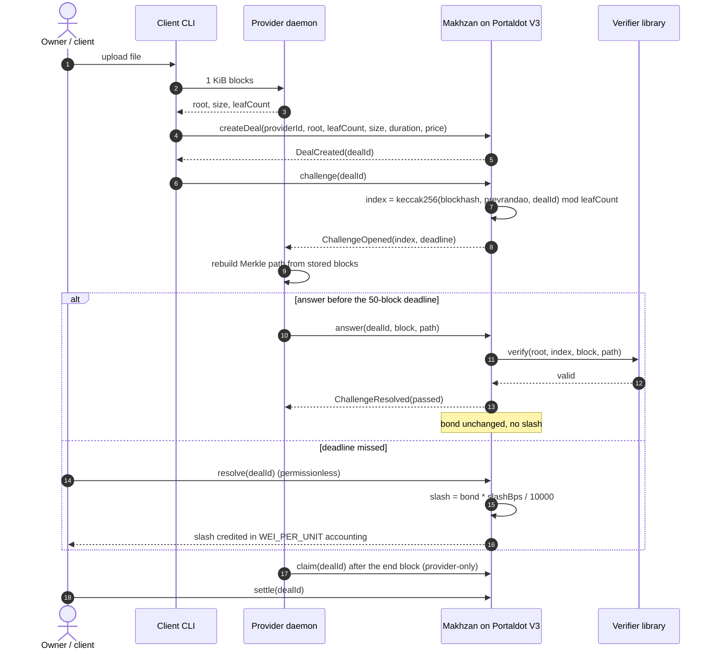

# Architecture — Makhzan

Makhzan is four pieces: a Solidity contract on Portaldot V3, a verifier library, a provider daemon,
and a client CLI. The contract owns money and state; the daemon owns bytes; the CLI is the client's
tool. This document is the component and sequence view behind the diagram in
[README.md](../README.md).

## Components

| Component | Path | Responsibility |
| --- | --- | --- |
| Makhzan contract | `contracts/src/makhzan/Makhzan.sol` | Provider bonds, deal escrow, challenge window, answer verification, slash, claim/settle, `healthOf` |
| Interface | `contracts/src/makhzan/IMakhzan.sol` | 15 selectors including `healthOf` for consumer contracts |
| Verifier | `contracts/src/makhzan/lib/` | Keccak Merkle path check over 1 KiB blocks |
| Merkle (TS) | `apps/makhzan/src/merkle.ts` | Same tree and leaf rule as Solidity, golden vectors |
| Client CLI | `apps/makhzan/src/cliMain.ts`, `cli.ts` | `upload`, `create`, `register`, `challenge`, `watch`, `claim`, `settle`, `resolve`, `report`; env-only keys |
| Provider daemon | `apps/makhzan/src/daemonMain.ts`, `daemon.ts` | Poll deals, rebuild the challenged block path, submit, label only from a fresh read-back; `wrong`/`skip` drills |
| Deploy | `apps/makhzan/src/deploy.ts`, `scripts/deploy.mjs` | Network-explicit deploy, reserve guard, pending record/resume, calibration line, code and config read-back |
| Evidence | `apps/makhzan/src/evidence.ts`, `evidenceWriter.ts` | Raw receipts under `evidence/receipts/<network>/<hash>.json`, derived views, `makhzan.evidence/v0` bundle |
| Verify | `apps/makhzan/src/verify.ts` | Byte-for-byte `eth_getCode` comparison with the artifact |
| Doctor | `apps/makhzan/src/doctor.ts` | Read-only checks with an exact fix per failure; owner mapping FAIL is expected |
| Wrapper | `scripts/with-live-env.sh` | Loads exactly one burner key from the Tier-0 `.env` into the child env; never prints, writes or puts it on argv |

## Pass and slash sequence

The daemon sends `submitted` only after the send, then re-reads `challengeStateOf` and the provider
bond. Only a closed challenge with the expected bond movement becomes `passed` or `failed`; the tx
hash alone is never treated as success.

## Flow in words

1. **Upload.** The CLI splits the file into 1 KiB blocks and posts them to the daemon; both sides build
   the same Keccak Merkle tree. The root, size and leaf count go on-chain; the bytes stay off-chain.
2. **Deal.** `createDeal` escrows `price × WEI_PER_UNIT` wei, stores the provider id, root, leaf count,
   size, end block and price, and increments `nextDealId` (first deal is `1`).
3. **Challenge.** One open challenge per deal. The index comes from the documented D5 fallback
   (parent hash, `prevrandao`, deal id), not from a proven randomness beacon.
4. **Answer.** The daemon submits the block bytes and the sibling hashes. The contract checks the
   path length (`ceil(log2(leafCount))`), the index, and the recomputed root. Wrong length, wrong
   path, wrong block and late answers all fail closed.
5. **Resolve.** After the deadline anyone may resolve. A miss slashes exactly `slashBps` of the bond
   to the owner; the challenge becomes defaulted.
6. **Claim / settle.** After the end block the provider claims the accrued price (provider-only, bond
   untouched); the owner settles to release the deal. Pull payments make both steps explicit.

## State and invariants

- Slot 0 packs window, block size, slash bps, min bond, next deal id, provider count, min/max duration
  (30 of 32 bytes). Slot 1 maps addresses to provider ids; slot 2 is the provider array; slot 3 maps
  deal ids to deals.
- `WEI_PER_UNIT = 10_000`; every amount is stored in native units and converted at the boundary.
- A deal's escrow is released once; `claim` is exactly-once per accrual, `settle` closes the deal.
- A passed challenge moves no bond; a defaulted one moves exactly 20% at the reviewed `slashBps`.
- `healthOf` is read-only, storage-only and event-free.

## Evidence path

Every live or local transaction writes a raw receipt first (`evidence/receipts/<network>/<hash>.json`);
`addresses.json` and `txs.json` are derived views and are never hand-edited. A bundle uses the feature
003 schema (`makhzan.evidence/v0` and `makhzan.evidence-index/v0`), is immutable once written, and its
index carries the SHA-256 of the exact bytes. The deploy record, verify record, doctor output and
round records are linked from the README deployment section.
